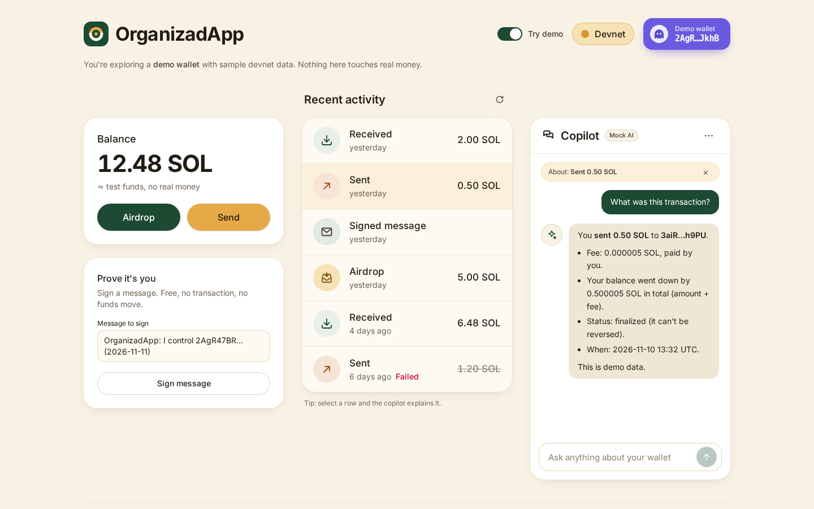
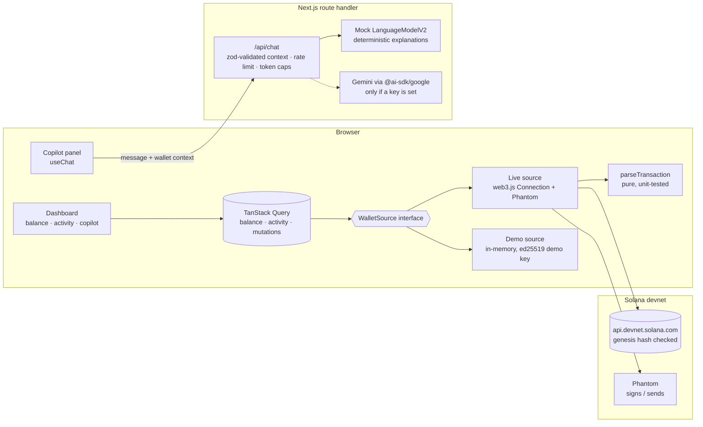

# OrganizadApp

**A Phantom-style Solana wallet experience on devnet, with an AI copilot that explains every transaction in plain language.**

OrganizadApp is a portfolio prototype. It shows how I build wallet UX in React and TypeScript: connecting Phantom, reading chain data through TanStack Query, signing and sending transactions with clear confirmation and status feedback, and adding an AI layer that turns a raw transaction into something a newcomer understands ("You sent 0.50 SOL to 9xQe…VFin. Fee: 0.000005 SOL, paid by you.").

It works **with zero setup**. Visitors without Phantom land in a realistic demo wallet, and the copilot uses a deterministic mock provider that implements the same model interface as a real LLM. Add a free Gemini key and the same code path talks to a real model.

> **Devnet only. Test funds, no real money.** The cluster is hard-coded to Solana devnet, checked at runtime against the devnet genesis hash, and there is no setting that points the app at mainnet.



**Live demo:** _coming soon_ <!-- replace with the Vercel URL once deployed -->

---

## Why

Wallets are where most people meet crypto, and most of them lose people at the first transaction screen. I wanted to build the two halves of a better experience:

1. **Wallet UX that feels like Phantom**: one purple connect button, a clear balance, Airdrop and Send with validation, an explicit confirm step, a signature you can open in the explorer, and an activity feed that reads like a bank statement.
2. **An explainer next to it**: click any row and the copilot says what happened, how much, with whom, what it cost and whether it is final, built only from the parsed transaction.

## Features

- **Connect Phantom** through `@solana/wallet-adapter-react`. Phantom is detected through the Wallet Standard, with `PhantomWalletAdapter` as a fallback. The purple button shows the truncated address and opens a menu (copy, view on Explorer, disconnect). Visitors without Phantom get an "Install Phantom" link.
- **Balance card** (SOL) with:
  - **Airdrop**: `requestAirdrop(1 SOL)` on devnet. Errors such as rate limits or the closed RPC faucet get a clear message and a link to faucet.solana.com.
  - **Send**: recipient and amount validation (valid base58 key, not yourself, at most 9 decimals, room left for the fee), then a review and **Confirm send** step. It sends through `wallet.sendTransaction`, confirms with a blockhash strategy, and shows the signature with a **Solana Explorer (devnet)** link.
- **Sign message**: `signMessage` in Phantom, verified in the browser with **tweetnacl** (ed25519) against the wallet's public key, then added to the activity feed.
- **Recent activity**: `getSignaturesForAddress` + `getParsedTransactions` via react-query, parsed into **Received / Sent / Airdrop / Signed message** (plus a fallback for program interactions), with relative times, amounts, fee payer and failed status. Parsing reads top-level and inner (CPI) system transfers and nets transfers in both directions.
- **AI copilot** (`useChat`, AI SDK 5): click a row and it asks "What was this transaction?". The answer covers amount, counterparty, fee and status. You can also ask free-form questions about your balance, fees, airdrops or whether the funds are real. The selected transaction shows as a chip with an Explorer link.
- **Demo mode**: the default for visitors without Phantom, with a **Try demo** switch for everyone else. It uses an in-memory wallet with realistic data, latency, a rate-limited faucet and a real ed25519 demo key, so even "Sign message" verifies for real. Demo signatures are labelled "not on chain" instead of linking to the explorer.
- **Accessible**: labelled controls, `aria-invalid` and `aria-describedby` on form errors, `aria-live` regions for airdrop, send and sign status, `role="log"` for the conversation, `role="switch"` for demo mode, visible focus rings, reduced-motion support, and stacked columns on mobile (the view scrolls to the copilot when you pick a row).

## Architecture



**Data flow.** Components never call the RPC directly. They use react-query hooks (`useBalance`, `useActivity`, `useAirdrop`, `useSend`, `useSignMessage`) keyed by `[mode, address]`. These hooks call a `WalletSource`. The live source reads devnet through `Connection` and writes through the connected wallet. The demo source behaves the same way in memory. Mutations invalidate the wallet's queries, with a second refetch for live mode because `getSignaturesForAddress` can lag confirmation by a moment.

**Copilot flow.** `useChat` posts the conversation plus a small **wallet context** (mode, address, balance, the last 10 activity rows and the selected row). The route validates it with zod, rate-limits by client, and puts it in the system prompt. Then it calls `streamText` with the mock model or Gemini. The mock reads that same context block and builds its answer from the transaction fields, so the mock path and the real path are the same code path.

### Project structure

```
src/
  app/
    api/chat/route.ts          # streamText, zod-validated context, rate limit, provider info (GET)
    layout.tsx · page.tsx · providers.tsx (Query + Connection + Wallet providers) · globals.css
  components/
    ui/                        # Button, Badge, Card, Field, StatusRegion, Skeleton, icons (+ stories)
    wallet/                    # PhantomButton, DevnetBadge, DemoToggle, BalanceCard, SendForm, SignMessageCard
    activity/                  # ActivityList / ActivityRow
    copilot/                   # CopilotPanel, MarkdownLite
    layout/dashboard.tsx       # wires wallet, sources, queries and the copilot
  lib/
    solana/                    # cluster (devnet guard, explorer URLs), parse, format, validation, types
    wallet/                    # WalletSource, live + demo sources, react-query hooks, local log, signing
    ai/                        # context schema, system prompt, provider selection, rate limit
    ai/mock/                   # mock LanguageModelV2, intent routing, transaction explanations
tests/unit/                    # Vitest
e2e/                           # Playwright (demo mode, no wallet needed)
.storybook/                    # Storybook (react-vite)
```

## Devnet safety

- `RPC_ENDPOINT` is a constant (`https://api.devnet.solana.com`). `assertDevnetEndpoint` refuses anything that isn't a devnet host.
- In live mode, write actions stay disabled until `getGenesisHash()` matches the devnet genesis hash.
- Explorer links always carry `?cluster=devnet`.
- The Devnet badge and the "test funds, no real money" note are always visible. The copilot's system prompt also restates that it's a test network, that it can't move funds, and that it must never ask for seed phrases.
- To try it with Phantom, turn on **Testnet Mode** in Phantom's developer settings and pick **Solana Devnet**, then get test SOL from the in-app Airdrop or [faucet.solana.com](https://faucet.solana.com).

## Tech decisions and tradeoffs

- **One `WalletSource` interface for live and demo.** Every component and hook runs the same code in both modes, demo mode exercises the real UI paths (validation, pending states, errors), and E2E tests need no wallet extension. _Tradeoff:_ the live source is covered by unit tests of its pure parts (parsing, validation, signing), not by an automated test against Phantom.
- **TanStack Query for all chain data.** Balance and activity are cached per mode and address, polled gently in live mode, and invalidated by mutations. The genesis check is a query with `staleTime: Infinity`.
- **A pure transaction parser** typed against a structural subset of `ParsedTransactionWithMeta`, so tests build fixtures as plain objects. Airdrops aren't labelled by the RPC, so the app remembers which signatures it requested as airdrops (per address, in `localStorage`). Signed messages never go on chain and are stored the same way. _Tradeoff:_ an airdrop made outside the app shows as "Received".
- **The mock is a real `LanguageModelV2`**, not an `if (mock)` branch. It streams through `streamText` and the UI message protocol exactly like Gemini, and it's deterministic, so E2E assertions are stable.
- **The copilot gets curated context, not RPC dumps.** A zod schema caps what the client can send (sizes, enums, at most 20 rows), which keeps prompts small and the route hard to abuse. Rate limiting, `maxOutputTokens` and message caps protect a free-tier key.
- **Custom Phantom button instead of `wallet-adapter-react-ui`**, to match the design system and keep the bundle and CSS small.
- **Text-based amount parsing** (no `<input type=number>`) with lamport rounding, so `0.1` is always exactly 100,000,000 lamports.

## Run locally

Requirements: Node 20.9+ (22 recommended).

```bash
npm install
npm run dev            # http://localhost:3000 (demo mode + mock copilot, no keys needed)
```

### Optional: real LLM (Gemini free tier)

```bash
cp .env.example .env.local
# set GOOGLE_GENERATIVE_AI_API_KEY=... (from https://aistudio.google.com/apikey)
# optional: GEMINI_MODEL=gemini-2.5-flash
npm run dev
```

The copilot badge switches from "Mock AI" to "Gemini". The key is read only on the server (no `NEXT_PUBLIC_` prefix). Set `COPILOT_PROVIDER=mock` to force the mock even when a key is present.

## Scripts

| Script                    | What it does                                                 |
| ------------------------- | ------------------------------------------------------------ |
| `npm run dev`             | Next.js dev server                                           |
| `npm run build` / `start` | Production build / server                                    |
| `npm run lint`            | ESLint (next/core-web-vitals + typescript, Prettier compat)  |
| `npm run format:check`    | Prettier                                                     |
| `npm run typecheck`       | `tsc --noEmit` (strict, `noUncheckedIndexedAccess`)          |
| `npm test`                | Vitest unit tests (parsing, formatting, validation, copilot) |
| `npm run test:e2e`        | Playwright against `next start` in demo mode (build first)   |
| `npm run storybook`       | Component workbench on http://localhost:6006                 |
| `npm run ci`              | Lint, format check, typecheck, unit tests and build in a row |

For E2E the first time: `npx playwright install chromium`.

CI (`.github/workflows/ci.yml`, `ubuntu-24.04`) runs lint, format check, typecheck, unit tests and a Storybook build, then a production build and the Playwright suite. No secrets are required.

## Limitations

- Devnet faucets are unreliable. The public RPC faucet often returns 429 or reports it is closed, so the app surfaces that and links to faucet.solana.com.
- Activity shows the last 12 signatures (no pagination yet), and only SOL transfers are described in detail. SPL tokens and other programs fall back to "Program interaction".
- The in-memory rate limiter is per server instance. A shared store (Upstash or Vercel KV) would fix that in production.
- Mobile wallets (Solana Mobile Wallet Adapter) are wired in by the provider but untested.

## Roadmap

- SPL token balances and transfers, with token metadata.
- Deploy on Vercel with Gemini by default, keeping mock mode for previews and CI.
- Copilot tools: "draft a send" that pre-fills the form (the user still confirms in Phantom), and fee or priority-fee explanations from recent blocks.
- Paginated activity with `useInfiniteQuery`.

## License

[MIT](LICENSE) © Gustavo Estay
